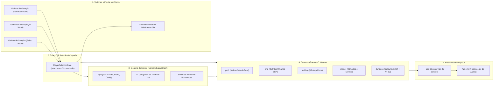
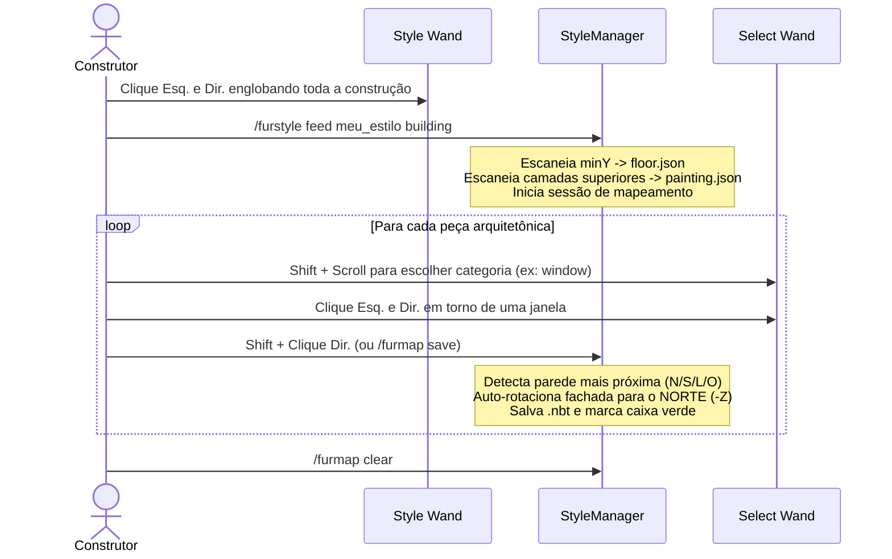
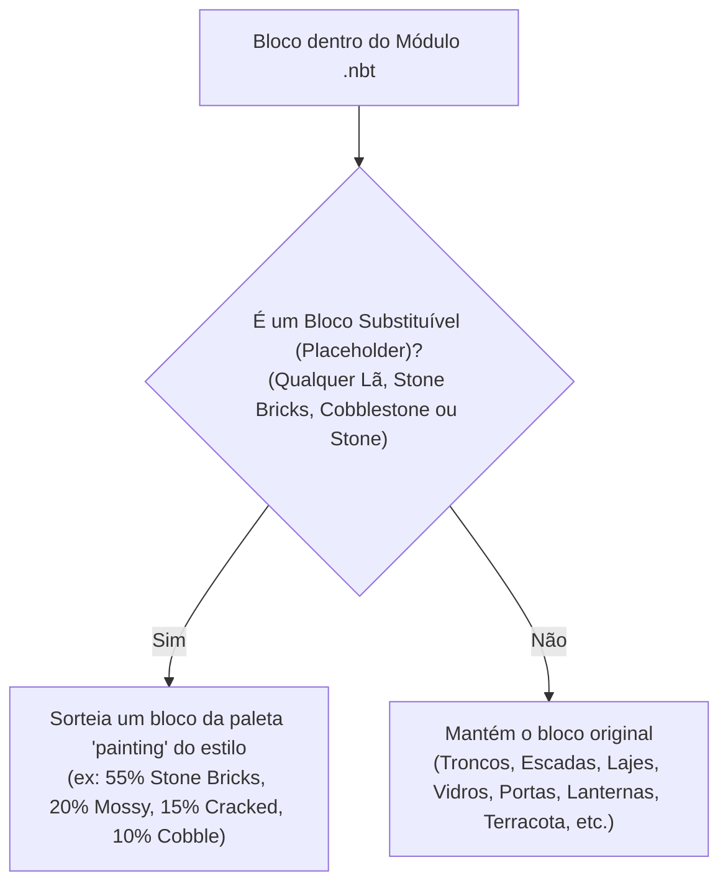
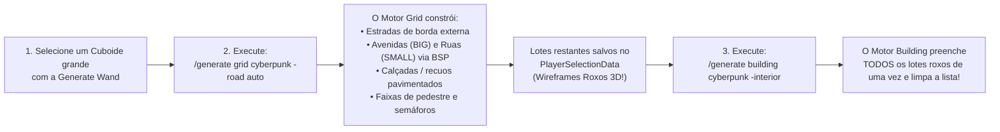
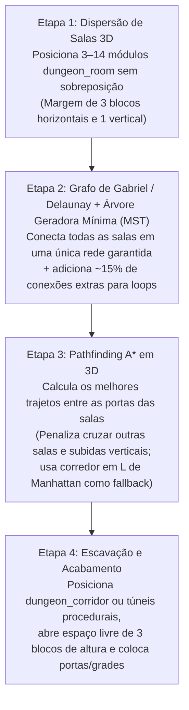

# NextFUR FurBuild (`furbuild`) — Guia Completo do Usuário e do Builder

> **Versão:** `1.0.0` | **Minecraft:** `1.21.1` | **Loader:** NeoForge `21.1.215` | **Idiomas:** `en_us`, `pt_br`

O **FurBuild** é um mod de geração procedural modular de construções, grades urbanas, interiores, estradas e masmorras (*dungeons*), criado pela NextFUR para o FurSMP. Em vez de colar estruturas rígidas e repetitivas, o FurBuild permite que você **crie seus próprios estilos arquitetônicos** (do zero ou alimentando construções existentes), **escaneie paletas de blocos com pesos** e **gere estruturas e distritos inteiros** de forma assíncrona sem causar lag no servidor.

---

## Índice

1. [Arquitetura e Fluxo Principal](#1-arquitetura-e-fluxo-principal)
2. [Tutorial Parte 1: Começando em 60 Segundos](#2-tutorial-parte-1-começando-em-60-segundos)
3. [Tutorial Parte 2: Dominando as 3 Varinhas e Wireframes 3D](#3-tutorial-parte-2-dominando-as-3-varinhas-e-wireframes-3d)
4. [Tutorial Parte 3: Criando Estilos Personalizados e Módulos 3D](#4-tutorial-parte-3-criando-estilos-personalizados-e-módulos-3d)
5. [Tutorial Parte 4: Paletas de Blocos e o "Painting Pass"](#5-tutorial-parte-4-paletas-de-blocos-e-o-painting-pass)
6. [Tutorial Parte 5: Guia Detalhado dos 5 Motores de Geração](#6-tutorial-parte-5-guia-detalhado-dos-5-motores-de-geração)
7. [Configuração, Schemas JSON e Referência de Comandos](#7-configuração-schemas-json-e-referência-de-comandos)
8. [Desempenho, Fila de Undo/Redo e Solução de Problemas](#8-desempenho-fila-de-undoredo-e-solução-de-problemas)

---

## 1. Arquitetura e Fluxo Principal

Tudo no FurBuild gira em torno de quatro sistemas conectados: **Varinhas e Seleções**, **Estilos e Paletas**, **Motores de Geração** e a **Fila de Posicionamento por Tick**.



### Ciclo Básico em Resumo
1. **Escolha ou Crie um Estilo:** Comece imediatamente com um dos 4 presets integrados (`medieval`, `cyberpunk`, `nordic`, `desert`), ou crie o seu próprio usando módulos `.nbt` e paletas.
2. **Selecione uma Área:** Use a **Varinha de Geração (Generate Wand)** no modo `CUBOID`, `POLYGON`, `CYLINDER` ou `SPLINE` para delimitar onde a construção será gerada.
3. **Execute `/generate`:** Escolha um dos 5 motores (`path`, `grid`, `building`, `interior`, `dungeon`) e personalize com flags (`-floors`, `-btype`, `-interior`, `-seed`, etc.).
4. **Acompanhe e Ajuste:** O FurBuild posiciona **500 blocos por tick** com sons e partículas. Se quiser testar outro layout ou seed, use `/ud` para desfazer ou `/rd` para refazer.

---

## 2. Tutorial Parte 1: Começando em 60 Segundos

### Requisitos e Permissões
- **Operador / Nível de Permissão 2** é necessário para usar `/furwand`, `/furstyle`, `/furmap`, `/generate`, `/ud`, `/rd` e `/furbuild presets`.
- **Todos os jogadores** podem abrir o menu interativo de ajuda clicável no chat a qualquer momento com:
  ```text
  /furbuild help
  /furhelp [overview|wands|style|generate|flags|presets|undo]
  ```

### Obtendo as Varinhas
Abra o inventário do Criativo e acesse a aba **NextFUR FurBuild**, ou receba os itens via comando:

```mcfunction
/give @s furbuild:generate_wand
/give @s furbuild:style_wand
/give @s furbuild:select_wand
```

### Explorando os 4 Estilos Predefinidos (Presets)
Quando um mundo ou servidor inicia, o FurBuild instala automaticamente **4 presets arquitetônicos completos** em `<world>/furbuild/styles/`. Você também pode reinstalá-los ou restaurá-los a qualquer momento com `/furstyle presets` (ou `/furbuild presets true`).

| Preset | `window_frequency` Padrão | Paleta `painting` | Paleta `path_blocks` | Paleta `floor` | Detalhes Característicos |
| :--- | :---: | :--- | :--- | :--- | :--- |
| **`medieval`** | `2` | `stone_bricks`, `mossy_stone_bricks`, `cracked_stone_bricks`, `cobblestone` | `cobblestone`, `gravel`, `coarse_dirt`, `mossy_cobblestone` | `spruce_planks`, `oak_planks` | Telhados duas águas com vigas de madeira, janelas de sótão, floreiras com alçapões, janelas salientes (*oriels*), criptas |
| **`cyberpunk`** | `1` | `polished_deepslate`, `deepslate_tiles`, `black_concrete`, `cyan_terracotta` | `black_concrete`, `gray_concrete`, `polished_basalt` | `smooth_stone`, `polished_deepslate` | Janelas duplas de vidro ciano, unidades de ar-condicionado com antena, letreiros de neon verticais, HVAC e torres de rádio no topo |
| **`nordic`** | `2` | `spruce_planks`, `stripped_spruce_log`, `cobblestone`, `mossy_cobblestone` | `coarse_dirt`, `podzol`, `gravel`, `cobblestone` | `spruce_planks`, `dark_oak_planks` | Janelas com barras de ferro, telhados de pinheiro, floreiras com venezianas, barris e lanternas rústicas |
| **`desert`** | `2` | `cut_sandstone`, `smooth_sandstone`, `sandstone`, `terracotta` | `sandstone`, `smooth_sandstone`, `orange_terracotta` | `smooth_sandstone`, `birch_planks` | Telhados planos de adobe com parapeito e pontas de vigas de madeira, muxarabis salientes (*mashrabiya*), toldos de terracota |

### Sua Primeira Construção Procedural (Passo a Passo)
Vamos gerar uma mansão medieval mobiliada de 3 andares em menos de um minuto:

1. Segure a **Varinha de Geração (Generate Wand)** (`furbuild:generate_wand`). Por padrão, ela inicia no modo `CUBOID`.
2. Encontre um terreno plano. Dê um **Clique Esquerdo** em um bloco de canto para definir o **Ponto A** (uma caixa verde aparece).
3. Ande diagonalmente cerca de **15–20 blocos** e dê um **Clique Direito** no bloco oposto para definir o **Ponto B** (um ponto azul-claro e uma caixa dourada delimitam o volume).
4. Execute o comando de geração:
   ```text
   /generate building medieval -floors 3 -btype manor -interior
   ```
5. Observe a construção surgir camada por camada a ~500 blocos/tick, completa com telhados inclinados, torre de esquina com bandeira vermelha, floreiras, cômodos, escadas e móveis!
6. Não gostou do local ou quer testar outra seed?
   - Use `/ud` para restaurar todos os blocos ao estado anterior exato.
   - Use `/rd` para refazer a geração.

---

## 3. Tutorial Parte 2: Dominando as 3 Varinhas e Wireframes 3D

O FurBuild separa **geração de construções**, **captura de estilos** e **mapeamento de objetos** em três ferramentas dedicadas. Cada varinha sincroniza sua seleção com o cliente e renderiza guias 3D em tempo real no mundo.

### 1. Varinha de Geração (`Generate Wand` — `furbuild:generate_wand`)
Usada para definir a área ou o trajeto do comando `/generate`.

- **Alternar Formato de Seleção:** Segure **`Shift + Roda do Mouse (Scroll)`** com a varinha na mão, ou execute:
  ```text
  /furwand mode <cuboid|polygon|cylinder|spline>
  ```
  *(Sinônimos aceitos: `circle` para `cylinder`, `polyline` para `spline`.)*
- **Limpar Tudo:** `/furwand clear` apaga todos os pontos selecionados, sessões da Select Wand e lotes urbanos salvos.

```text
  CUBOID (2 cantos)             POLYGON (3..N vértices)        CYLINDER (Centro + Borda)      SPLINE (2..N pontos)
  +------------------+ B        P1 -------- P2                        . - .                      P1 ~ ~ ~ .
  |                  |          |             \                    .    |r   .                              ~ ~ P2
  |   Caixa 3D       |          |   Formato    P3                (      C ---- E )                                 ~
  |                  |          |   L / U     /                    .         .                                       ~ P3
A +------------------+          P5 -------- P4                        ' - '
  Esq.: A | Dir.: B             Esq.: P1 | Dir.: +Ponto          Esq.: C | Dir.: Borda/Alt.    Esq.: P1 | Dir.: +Ponto
```

| Modo | Ação no Clique Esquerdo | Ação no Clique Direito | Melhor Uso |
| :--- | :--- | :--- | :--- |
| **`CUBOID`** | Define o **Ponto A** | Define o **Ponto B** | `building`, `grid`, `interior`, `dungeon` |
| **`POLYGON`** | Reinicia e define o **Vértice 1** | Adiciona os **Vértices 2..N** | `building` (formatos em L, U, paredes angulares) |
| **`CYLINDER`** | Define o **Centro** `(cx, minY, cz)` | Define o **Raio e Altura** `(edgeX, maxY, edgeZ)` | `building` (torres redondas de mago, silos) |
| **`SPLINE`** | Reinicia e define o **Ponto 1** | Adiciona os **Pontos 2..N** | `path` (estradas orgânicas em curva Catmull-Rom) |

> [!TIP]
> No modo `POLYGON`, se todos os vértices clicados estiverem na mesma altura `Y`, a prévia 3D extruda automaticamente 3 blocos para cima (+1 = 4 blocos visuais) para facilitar a visualização do contorno.

---

### 2. Varinha de Estilo (`Style Wand` — `furbuild:style_wand`)
Opera sempre como seletor **Cuboide** para definir estilos, módulos e paletas:
- **Clique Esquerdo no Bloco:** Define o **Ponto A** do cuboide.
- **Clique Direito no Bloco:** Define o **Ponto B** do cuboide.
- Usada pelos comandos:
  - `/furstyle add <estilo> <categoria> <nome> [peso]` — Salva um módulo 3D `.nbt` isolado.
  - `/furstyle addpalette <estilo> <tipo_paleta>` — Escaneia a proporção de blocos dentro da seleção.
  - `/furstyle feed <estilo> [tipo_local]` — Alimenta uma construção pronta para o modo **Feed & Map**.

---

### 3. Varinha de Seleção (`Select Wand` — `furbuild:select_wand`)
Usada **dentro** de uma sessão Feed & Map para recortar peças individuais (janelas, paredes, portas, móveis, semáforos) diretamente de uma construção existente:
- **Alternar Categoria do Objeto:** Segure **`Shift + Scroll`** (ou execute `/furmap type <categoria>`).
- **Clique Esquerdo no Bloco:** Define o **Ponto A do Objeto**.
- **Clique Direito no Bloco:** Define o **Ponto B do Objeto**.
- **`Shift + Clique Direito`** (em um bloco ou no ar) ou `/furmap save`: Salva imediatamente o objeto selecionado no estilo alimentado, rotaciona fachadas automaticamente para o **NORTE (`-Z`)** e exibe uma caixa verde persistente para marcar o que já foi mapeado!

---

### Tabela de Cores dos Wireframes 3D

Ao segurar qualquer varinha do FurBuild, o `SelectionRenderer` desenha contornos coloridos no mundo:

| Cor | Significado | Visível ao Segurar |
| :--- | :--- | :--- |
| **Verde** | Ponto Inicial (`Pos A` / `Ponto 1` / Centro do Cilindro) | Generate Wand / Style Wand |
| **Azul Claro** | Ponto Secundário (`Pos B` / `Pontos 2..N` / Borda do Cilindro) | Generate Wand / Style Wand |
| **Dourado / Amarelo** | Caixa `CUBOID` completa, borda superior de `POLYGON` e `CYLINDER` | Generate Wand / Style Wand |
| **Ciano / Água** | Base de `POLYGON` e `CYLINDER`, curva `SPLINE`, ou **Ponto A da Select Wand** | Generate Wand (por modo) / Select Wand + Style Wand |
| **Laranja** | Pontos `2..N` no modo `SPLINE` | Generate Wand (modo `SPLINE`) |
| **Magenta / Rosa** | **Ponto B da Select Wand** e **Caixa de Seleção do Objeto** ativa | Select Wand / Style Wand |
| **Verde Brilhante** | Objetos já mapeados durante uma sessão `/furstyle feed` ativa | Select Wand / Style Wand |
| **Roxo** | **Lotes Urbanos (City Plots)** gerados por `/generate grid` aguardando `/generate building` | Qualquer Varinha do FurBuild |

---

## 4. Tutorial Parte 3: Criando Estilos Personalizados e Módulos 3D

### Como os Estilos São Salvos no Disco
Cada estilo fica salvo na pasta do seu mundo em:

```text
<world>/furbuild/styles/<nome_do_estilo>/
├── style.json                      # Metadados, grid_size, module_height, config e lista de módulos
├── palettes/
│   ├── painting.json               # Pesos de blocos para envelhecimento/textura de paredes
│   ├── path_blocks.json            # Pesos de blocos para superfícies de estradas e caminhos
│   └── floor.json                  # Pesos de blocos para pisos internos
└── modules/
    ├── wall/
    │   ├── standard_wall.nbt       # StructureTemplate padrão do Minecraft (.nbt)
    │   └── arched_wall.nbt
    ├── window/
    │   └── framed_window.nbt
    ├── door/
    │   └── main_entrance.nbt
    └── ...                         # Organizado pelo nome da ModuleCategory
```

O FurBuild oferece **duas formas** de criar estilos: **Fluxo A (Do Zero)** e **Fluxo B (Feed & Map de Construções Prontas)**.

---

### Fluxo A: Construindo Módulos Isolados do Zero

#### Passo 1: Inicializar o Estilo
```text
/furstyle create meu_reino 5
```
- `style_name`: Sanitizado automaticamente para minúsculas (`a-z`, `0-9`, `_`, `-`).
- `grid_size` (opcional, `1–64`, padrão `5`): A largura em blocos de cada segmento modular de fachada (`wall`, `window`, `door`).
- `module_height` começa em `4` e atualiza automaticamente para a altura (`Y`) sempre que você salva um módulo `wall`, `window` ou `door`.

#### Passo 2: A Regra de Ouro da Orientação — Sempre Virado para o NORTE (`-Z`)
Ao construir módulos isolados para `/furstyle add`, **construa sempre a frente externa virada para o NORTE (`-Z`)**! Durante a geração, o FurBuild rotaciona seu template Norte em `0°`, `90°`, `180°` ou `270°` para encaixar em todos os lados de prédios, polígonos, cilindros e estradas.

```text
                    NORTE (-Z)  <-- Frente Externa (Janelas, Venezianas, Frente da Porta)
                        ▲
                        |
        OESTE (-X) ◄----+----► LESTE (+X)
                        |
                        ▼
                    SUL (+Z)    <-- Lado Interno / Traseiro

  Exemplo de Módulo de Fachada 5x4x1 (Vista de Cima):
  Z = 0 :  [Tronco] [Tijolo] [Vidro] [Tijolo] [Tronco]   <-- Virado para o NORTE (-Z)
              0        1        2       3        4  (X)
```

> [!TIP]
> **Usando `minecraft:structure_void`:** Tanto `/furstyle add` quanto `/furmap save` ignoram blocos de `structure_void` ao capturar templates. Use `structure_void` nos espaços vazios de ornamentos salientes (como sacadas ou toldos) se você não quiser que blocos de ar do template apaguem blocos da parede atrás deles!

#### Passo 3: Capturar Módulos com Pesos
1. Selecione os cantos do módulo com a **Varinha de Estilo (Style Wand)** (Clique Esquerdo no Ponto A, Clique Direito no Ponto B).
2. Salve na categoria desejada:
   ```text
   /furstyle add meu_reino wall parede_lisa 1.0
   /furstyle add meu_reino wall parede_estandarte 0.35
   /furstyle add meu_reino window janela_arco 1.0
   /furstyle add meu_reino door porta_carvalho 1.0
   ```
   - `weight` (`0.01–1000.0`, padrão `1.0`): Pesos maiores fazem aquela variante aparecer com mais frequência quando o gerador sorteia um módulo da categoria.

---

### Fluxo B: Engenharia Reversa de Construções Prontas ("Feed & Map")

Já construiu uma casa incrível, um interior de taverna ou uma rua à mão? Você não precisa reconstruir cada módulo virado para o Norte! Use o fluxo **Feed & Map** para extrair paletas e recortar peças diretamente de qualquer parede da construção pronta.



#### Passo a Passo
1. **Alimente a Construção Inteira:**
   - Equipe a **Varinha de Estilo (Style Wand)** e selecione toda a caixa envolvente da sua construção, interior ou rua pronta.
   - Execute:
     ```text
     /furstyle feed meu_estilo building
     ```
     *(Valores válidos para `place_type`: `building`, `interior`, `road`, `dungeon`. Sinônimo: `/furmap start meu_estilo building`.)*
   - **Extração Automática de Paletas:**
     - Para `building`, `interior` ou `dungeon`: Blocos sólidos inteiros na camada inferior (`minY`) viram `palettes/floor.json`, e blocos sólidos das camadas superiores viram `palettes/painting.json`.
     - Para `road` (ou `path` / `street`): Todos os blocos sólidos da seleção são combinados em `palettes/path_blocks.json`.
2. **Mapeie Objetos Individuais com a Varinha de Seleção (`Select Wand`):**
   - Equipe a **Varinha de Seleção (Select Wand)**.
   - Segure `Shift + Scroll` (ou `/furmap type <categoria>`) para escolher a categoria (ex.: `wall`, `window`, `door`, `window_ornament`, `balcony`, `chimney`, `interior_wall`).
   - Dê **Clique Esquerdo** em um canto da janela/parede/móvel e **Clique Direito** no canto oposto.
   - Pressione **`Shift + Clique Direito`** (ou execute `/furmap save [categoria] [nome_modulo] [peso]`).
   - **Auto-Rotação Inteligente:** Se a categoria for uma fachada direcional (`wall`, `window`, `window_ornament`, `door`, `balcony`, `interior_wall`, `pillar`, `trim`), o FurBuild verifica qual lado da construção alimentada está mais próximo do objeto e rotaciona automaticamente peças do Leste, Sul ou Oeste para que sejam salvas viradas para o **NORTE (`-Z`)**!
3. **Finalize:** Use `/furmap clear` (ou `/furwand clear`) quando terminar.

---

### Referência Completa: Todas as 27 Categorias de Módulos

#### A. Categorias de Construção e Exterior
| Categoria | Auto-Rotacionada? | Tamanho Típico | Papel no `BuildingGeneratorEngine` |
| :--- | :---: | :---: | :--- |
| `wall` | Sim | `5x4x1` | Segmentos de parede sólida (também atua como fallback se faltar `window`/`door`/`pillar`) |
| `corner` | Não | `1x4x1` | Pilares verticais de canto posicionados em cada vértice do polígono/cuboide por andar |
| `window` | Sim | `5x4x1` | Segmentos de parede com janelas, distribuídos conforme `window_frequency` / `-winfreq` |
| `window_ornament` | Sim | `5x4x1` ou `5x4x2` | Ornamentos externos posicionados para fora diante de segmentos `window` (venezianas, floreiras, ACs, letreiros neon, toldos) |
| `door` | Sim | `5x4x1` | Segmento de entrada no térreo (posicionado uma vez no andar 0 e em entradas de masmorra) |
| `roof` | Não | `5x3x5` | Categoria registrada de módulos de telhado *(Obs.: os arquétipos integrados geram telhados adaptativos de duas águas, parapeito de adobe, cornija urbana ou cone, exceto se `-exclude roof` for usado)* |
| `balcony` | Sim | `5x2x2` | Posicionado para fora abaixo/à frente de janelas de andares superiores (`f > 0`) |
| `pillar` | Sim | `5x4x1` | Segmentos de colunata/arcada alternados em `hall` e no térreo de `apartment` |
| `trim` | Sim | `5x1x1` | Cornija horizontal externa entre andares nos pisos superiores (`f > 0`) |
| `chimney` | Não | `1x4x1` | Posicionada nos telhados de `house`, `standard` e `manor` |
| `building` | Não | Qualquer | Templates completos de edifícios usados com `-btype template` (ou 15% de chance no modo `auto`) |
| `ornament` | Não | `1x4x1` | Decorações gerais (centro de pátio em `courtyard`, pátio em `l_shape`, fallback de `road_ornament` / `window_ornament`) |

#### B. Categorias de Interior
| Categoria | Auto-Rotacionada? | Tamanho Típico | Papel no `InteriorGeneratorEngine` |
| :--- | :---: | :---: | :--- |
| `interior_prop` | Não | `3x2x1` | Fallback geral de mobília para `interior_wall`, `interior_center` e salas de dungeon |
| `interior_wall` | Sim | `3x2x1` | Móveis encostados na parede (estantes, bancadas, baús) ao longo do perímetro dos cômodos |
| `interior_center` | Não | `2x2x2` | Móveis centrais (mesas, tapetes) posicionados no centro dos cômodos |
| `interior_ceiling` | Não | `1x2x1` | Lustres ou lanternas suspensas no teto (`ceilingY`) no centro dos cômodos |
| `interior_corner` | Não | `1x2x1` | Suportes de canto, vasos ou armazenamento em cantos dos cômodos |

#### C. Categorias de Estradas e Grade Urbana
| Categoria | Sinônimos | Tamanho Típico | Papel no `GridGeneratorEngine` e `PathGeneratorEngine` |
| :--- | :--- | :---: | :--- |
| `road_segment` | — | `5x1x5` | Segmento de estrada fallback quando não há `road_small` ou `road_big` |
| `road_small` | `small_road` | `3x1x5` | Rua local estreita (sua largura em `X` define a largura das ruas pequenas no `grid`) |
| `road_big` | `big_road`, `large_road` | `7x1x5` | Avenida larga (sua largura em `X` define a largura das avenidas no `grid`) |
| `intersection` | — | `5x1x5` | Cruzamento padrão colocado onde duas ruas pequenas se encontram |
| `intersection_big` | `big_intersection`, `large_intersection` | `7x1x7` | Grande cruzamento colocado quando ao menos uma avenida `BIG` participa da interseção |
| `road_signal` | `signal`, `traffic_signal` | `1x4x1` | Postes/semáforos nos 4 cantos dos cruzamentos do `grid` e ao longo de caminhos `path` |
| `road_ornament` | `street_ornament` | `1x4x1` | Postes de iluminação espaçados ao longo de calçadas e margens de caminhos |
| `road_prop` | `street_prop` | `2x1x1` | Bancos, barris e caixas espaçados ao longo de calçadas e caminhos |

#### D. Categorias de Masmorra (Dungeon)
| Categoria | Auto-Rotacionada? | Tamanho Típico | Papel no `DungeonGeneratorEngine` |
| :--- | :---: | :---: | :--- |
| `dungeon_room` | Não | `7x5x7` | Câmaras 3D não sobrepostas espalhadas dentro da caixa selecionada |
| `dungeon_corridor` | Não | `3x4x3` | Segmentos de corredor posicionados ao longo dos caminhos A* entre salas |

---

## 5. Tutorial Parte 4: Paletas de Blocos e o "Painting Pass"

### Os 3 Tipos de Paleta
1. **`painting`** — Usada para envelhecimento/variação de paredes, paredes procedurais, calçadas, divisórias internas e paredes de masmorras.
2. **`path_blocks`** — Usada para estradas em spline (`/generate path`) e superfícies procedurais de ruas (`/generate grid`).
3. **`floor`** — Usada para os pisos horizontais de cada andar (`/generate interior` e `-interior`).

### Escaneando uma Paleta Dentro do Jogo
Você não precisa calcular porcentagens manualmente no JSON! Basta montar uma pequena amostra de blocos no chão:

1. Coloque uma amostra de blocos no mundo. Por exemplo, 10 blocos no total:
   - `6x` Tijolos de Pedra (`60%`)
   - `2x` Tijolos de Pedra com Musgo (`20%`)
   - `2x` Tijolos de Pedra Rachados (`20%`)
2. Selecione esses 10 blocos com a **Varinha de Estilo (Style Wand)** (Ponto A ao Ponto B).
3. Execute:
   ```text
   /furstyle addpalette meu_reino painting
   ```
4. O FurBuild ignora ar e `structure_void`, conta cada tipo de bloco, normaliza os pesos e grava `palettes/painting.json`.

### Como Funciona o "Painting Pass" Secundário
Quando o FurBuild posiciona **qualquer módulo 3D `.nbt`** no mundo (`TemplatePlacementHelper`), ele analisa cada bloco do template:



> [!IMPORTANT]
> **Dica de Design:** Construa as paredes de preenchimento dos seus módulos `.nbt` usando **Lã Branca (`white_wool`)** (ou `stone_bricks`, `cobblestone`, `stone`) nas áreas que você quer que recebam textura/envelhecimento automático, e use **troncos, escadas, lajes, terracota, concreto ou tábuas** nas vigas e acabamentos que devem permanecer fixos!

---

## 6. Tutorial Parte 5: Guia Detalhado dos 5 Motores de Geração

Todos os cinco motores são acionados com:
```text
/generate <tipo> <estilo> [flags...]
```
As flags **não dependem de ordem** — você pode combiná-las em qualquer sequência.

---

### Motor 1: `path` (Estradas Orgânicas em Spline Catmull-Rom)
**Melhor Modo da Varinha:** `SPLINE` (ou `CUBOID` para um trajeto reto de 2 pontos).

1. Mude a Varinha de Geração para `SPLINE` (`Shift + Scroll` ou `/furwand mode spline`).
2. Dê **Clique Esquerdo** no ponto inicial e **Clique Direito** em 2, 3 ou mais pontos intermediários serpenteando por colinas ou vales.
3. Execute:
   ```text
   /generate path nordic -road big -seed 101
   ```

**Como funciona:**
- Amostra uma curva suave **Catmull-Rom** (`SplineMath`) passando por todos os pontos de controle.
- Aplica ruído orgânico nas bordas externas para misturar o caminho naturalmente ao terreno.
- Ajusta cada coluna `(x, z)` ao heightmap do terreno por padrão (`-align ground`), limpa 2 blocos de grama alta/plantas acima da estrada e posiciona `road_signal`, `road_prop` e `road_ornament` perpendicularmente nas margens.
- Largura padrão por `-road`: `small` = `3`, `auto` = `4`, `big` = `7` (ou force qualquer valor com `-width <int>`).

---

### Motor 2: `grid` (Distritos Urbanos BSP e Sinergia de Lotes)
**Melhor Modo da Varinha:** `CUBOID`

O gerador de grade urbana utiliza um **Fluxo de Construção de Cidade em 2 Etapas**:



**Detalhes:**
- **Larguras Baseadas nos Assets:** Lê primeiro os módulos `road_small` (largura padrão `3`) e `road_big` (largura padrão `7`) do seu estilo.
- **Recuos / Calçadas (`-distance`):** Cria uma faixa de calçada entre as ruas e os lotes usando `small_road_distance` (padrão `2`) e `big_road_distance` (padrão `3`), ou o valor explícito de `-distance <int>`.
- **Cruzamentos e Sinais:** Detecta sobreposições de vias, posiciona módulos `intersection` / `intersection_big` (ou cruzamentos procedurais com faixas de pedestres) e adiciona postes `road_signal` nos 4 cantos.
- **Sinergia de Lotes:** Ao terminar `/generate grid`, contornos roxos marcam todos os lotes disponíveis. Basta rodar `/generate building <estilo>` (com as flags desejadas, como `-interior` ou `-btype`) para preencher todos os lotes automaticamente! *(Se não quiser preenchê-los, rode `/furwand clear` para limpar os lotes salvos.)*

---

### Motor 3: `building` (Motor Arquitetônico Multi-Arquétipo)
**Melhores Modos da Varinha:** `CUBOID`, `POLYGON`, `CYLINDER` ou **Lotes Urbanos** salvos pelo `/generate grid`.

#### Todos os 12 Arquétipos de Construção (`-btype <tipo>`)
| `-btype` | Tamanho Mínimo | Andares Padrão | Descrição Arquitetônica |
| :--- | :---: | :---: | :--- |
| `auto` | Qualquer | Por altura/tipo | Seleção inteligente por tema: `desert` prioriza `cluster`/`courtyard`; `cyberpunk` prioriza `apartment`/`shop`/`tower`; `medieval`/`nordic` priorizam `manor`/`l_shape`/`hall`/`house` (+15% de chance de `template` se houver módulos `building`) |
| `standard` | Qualquer | 2–3 | Construção retangular clássica com telhado arquitetônico e chaminé |
| `house` | Qualquer | 2 | Casa residencial de 2 andares com chaminé e telhado do tema |
| `shop` | Qualquer | 2 | Loja comercial com alta densidade de janelas no térreo e andares superiores (`winfreq = 1`) e terraço/cornija |
| `tower` | Qualquer | 4–6 | Torre quadrada alta com térreo sem janelas, topo recuado e cobertura em pináculo com bandeira vermelha (ou topo urbano/adobe conforme o tema) |
| `l_shape` | `9x9` | 2–3 | Planta em L com 6 vértices, telhados cruzados, chaminé e decoração no pátio interno |
| `courtyard` | `15x15` | 2 | Anel retangular fechado ao redor de um pátio central aberto com lanterna/ornamento |
| `hall` | Qualquer | 2–3 | Salão nobre alternando colunatas `pillar` nas fachadas e alta frequência de sacadas (55%) |
| `manor` | `9x9` | 2–3 | Solar multi-alas: salão principal com telhado duas águas, ala frontal mais baixa, chaminé e torre de esquina com pináculo e mastro |
| `apartment` | `8x8` | 4–5 | Prédio urbano (formato em L recuado quando `>= 10x10`) com embasamento térreo, friso divisório, janelas duplas, letreiros neon verticais, cornija com dentículos, HVAC e torre de rádio no telhado |
| `cluster` | `9x9` | 3 | Composto escalonado de múltiplos volumes (torre principal + ala leste média + anexo sul de 1 andar) com parapeitos, vigas de madeira salientes e escada externa |
| `template` | Qualquer | N/A | Posiciona diretamente um módulo `.nbt` da categoria `building` com rotação aleatória |

#### Comportamento por Formato de Seleção
- **`CUBOID`:** Gera usando o arquétipo `-btype` escolhido e sistema completo de telhados (ou preenche todos os City Plots salvos de um `/generate grid` anterior).
- **`POLYGON`:** Traça o perímetro exato dos seus vértices com `corner`, `wall`, `window`, `door`, `window_ornament`, `balcony` e `trim`. Aceita `-interior`.
- **`CYLINDER`:** Constrói uma torre circular de pedra/madeira com o raio e altura selecionados, adicionando portas/janelas/ornamentos nas 4 faces cardeais e telhado cônico.

#### Frequência de Janelas (`-winfreq`)
Controla a cadência de módulos `window` ao longo das paredes:
- `1`: Em todos os segmentos (fachada densa/urbana).
- `2`: A cada 2 segmentos (ritmo clássico).
- `3`: A cada 3 segmentos (visual fortificado/esparso).
- `0` ou `varied` / `random`: Varia dinamicamente entre `1`, `2` e `3` a cada andar.

---

### Motor 4: `interior` (Divisão de Andares, Cômodos BSP e Móveis)
**Melhor Modo da Varinha:** `CUBOID` (ou acionado automaticamente via `/generate building <estilo> -interior`).

```text
  Andar N+1   [ Laje de Piso com Abertura 4x2 para Escada ]
                   ^
  Andar N     [ Escada ] | Sala A (Parede + Centro + Canto + Teto) | Porta 1x2 | Sala B
```

1. **Recuo de Paredes:** Recua automaticamente 1 bloco em `X` e `Z` quando a largura/comprimento for `> 6` para encaixar por dentro das fachadas externas.
2. **Fatiamento de Andares e Escadaria:** Preenche os pisos usando `palettes/floor.json` a cada `module_height` blocos, recortando um vão alinhado de `4x2` com escadas de carvalho e pé-direito livre.
3. **Subdivisão BSP de Cômodos:** Divide recursivamente andares maiores que `13` blocos (`minRoomDim = 6`) em cômodos conectados por portas de `1x2` em paredes internas (evitando bloquear a escada).
4. **População em 4 Zonas:**
   - **Teto (`interior_ceiling`):** Lustre ou lanterna pendurada no centro do teto.
   - **Centro (`interior_center` / `interior_prop`):** Mesa central ou tapete vermelho.
   - **Parede (`interior_wall` / `interior_prop`):** Estantes/bancadas rotacionadas para dentro ao longo das paredes.
   - **Canto (`interior_corner`):** Mesas de canto, barris, baús, bancadas de trabalho, estantes ou vasos.

---

### Motor 5: `dungeon` (Dispersão 3D, Delaunay/MST e Corredores A\*)
**Melhor Modo da Varinha:** `CUBOID` (garanta um bom volume 3D, como `40x16x40`).



---

## 7. Configuração, Schemas JSON e Referência de Comandos

### Configuração de Estilo (`/furstyle config`)
Personalize os padrões arquitetônicos de um estilo sem editar JSON à mão:
```text
/furstyle config <estilo> window_frequency <0..64>
/furstyle config <estilo> small_road_distance <0..64>
/furstyle config <estilo> big_road_distance <0..64>
```
- `window_frequency` (alias `winfreq`): Padrão `2` (`0` = variado).
- `small_road_distance` (alias `small_distance`): Padrão `2` blocos de calçada/recuo para ruas `SMALL`.
- `big_road_distance` (alias `big_distance`): Padrão `3` blocos de calçada/recuo para avenidas `BIG`.

### Configuração do Mod (`furbuild-common.toml`)
Localizado em `config/furbuild-common.toml` (e editável no jogo via **Mods -> FurBuild -> Config**):

```toml
#Enable NextFUR API integration and authentication
enableApiIntegration = true
#Base URL endpoint for the NextFUR API
apiEndpoint = "https://api.nextfur.net"
```

### Exemplos de Arquivos JSON

**`world/furbuild/styles/<estilo>/style.json`:**
```json
{
  "style_name": "medieval",
  "grid_size": 5,
  "module_height": 4,
  "window_frequency": 2,
  "small_road_distance": 2,
  "big_road_distance": 3,
  "modules": [
    {
      "name": "standard_wall",
      "category": "wall",
      "file": "modules/wall/standard_wall.nbt",
      "weight": 1.0,
      "size": [5, 4, 1]
    }
  ],
  "palettes": {
    "painting": "palettes/painting.json",
    "path_blocks": "palettes/path_blocks.json",
    "floor": "palettes/floor.json"
  }
}
```

**`world/furbuild/styles/<estilo>/palettes/painting.json`:**
```json
{
  "palette_type": "painting",
  "weights": {
    "minecraft:stone_bricks": 0.55,
    "minecraft:mossy_stone_bricks": 0.2,
    "minecraft:cracked_stone_bricks": 0.15,
    "minecraft:cobblestone": 0.1
  }
}
```

---

### Referência Completa de Comandos

| Comando | Permissão | Descrição |
| :--- | :---: | :--- |
| `/furbuild` / `/furbuild help [tópico]` | Todos | Abre a ajuda interativa clicável (`overview`, `wands`, `style`, `generate`, `flags`, `presets`, `undo`) |
| `/furhelp [tópico]` | Todos | Atalho para `/furbuild help [tópico]` |
| `/furbuild presets [force]` | Op (2) | Instala os 4 estilos preset (`force=true` sobrescreve presets existentes) |
| `/furwand mode <modo>` | Op (2) | Define o modo da Generate Wand (`cuboid`, `polygon`, `cylinder`/`circle`, `spline`/`polyline`) |
| `/furwand clear` | Op (2) | Limpa todos os pontos de seleção, sessões de mapeamento e lotes salvos |
| `/furstyle create <nome> [grid_size]` | Op (2) | Cria a pasta do estilo e o `style.json` (padrão `grid_size = 5`) |
| `/furstyle add <estilo> <cat> <nome> [peso]` | Op (2) | Salva a seleção cuboide da Style Wand como módulo `.nbt` |
| `/furstyle addpalette <estilo> <tipo>` | Op (2) | Escaneia a seleção da Style Wand para `painting`, `path_blocks` ou `floor` |
| `/furstyle feed <estilo> [tipo_local]` | Op (2) | Alimenta a construção da Style Wand, extrai paletas e inicia o mapeamento com Select Wand |
| `/furstyle map <estilo> [cat] [nome] [peso]` | Op (2) | Salva o objeto atual da Select Wand em `<estilo>` |
| `/furstyle config <estilo> <chave> <valor>` | Op (2) | Define `window_frequency`, `small_road_distance` ou `big_road_distance` (`0–64`) |
| `/furstyle list` | Op (2) | Lista todos os estilos salvos no mundo |
| `/furstyle info <estilo>` | Op (2) | Mostra tamanho da grade, altura, contagem de módulos/paletas e configs |
| `/furstyle presets` | Op (2) | Gera/reseta os 4 estilos predefinidos |
| `/furmap start <estilo> [tipo_local]` | Op (2) | Alias para `/furstyle feed` |
| `/furmap type <categoria>` | Op (2) | Define a categoria ativa da Select Wand |
| `/furmap save [cat] [nome] [peso]` | Op (2) | Salva o objeto da Select Wand no estilo atualmente alimentado |
| `/furmap clear` | Op (2) | Limpa a seleção da Select Wand e encerra a sessão de mapeamento |
| `/generate <tipo> <estilo> [flags...]` | Op (2) | Executa os motores `path`, `grid`, `building`, `interior` ou `dungeon` |
| `/ud` | Op (2) | Desfaz sua última geração (~500 blocos/tick) |
| `/rd` | Op (2) | Refaz sua última geração desfeita (~500 blocos/tick) |

---

### Referência Completa de Flags do `/generate`

| Flag | Aliases | Valores | Descrição e Exemplo |
| :--- | :--- | :--- | :--- |
| `-floors` | `-floor`, `-h` | `<int>` (`>= 1`) | Força a quantidade exata de andares (`-floors 4`) |
| `-btype` | `-buildingtype`, `-type` | ID do Arquétipo | Escolhe o arquétipo da construção (`-btype manor`, `-btype apartment`, `-btype cluster`, etc.) |
| `-winfreq` | `-windowfreq`, `-wf` | `<int>` ou `varied`/`random`/`auto` | Frequência de janelas: `1` (todo segmento), `2` (a cada 2), `3` (a cada 3), `0`/`varied` (dinâmico) |
| `-road` | `-roadtype` | `auto`, `small`, `big` | Nível da via em `grid` e `path` (`small`/`narrow`/`local`, `big`/`large`/`avenue`/`highway`) |
| `-distance` | `-setback`, `-dist` | `<int>` (`>= 0`) | Sobrescreve o recuo/calçada entre vias e lotes no `grid` (`-distance 3`) |
| `-seed` | `-s` | `<long>` ou `<texto>` | Define uma seed fixa para reproduzir o mesmo layout (`-seed 42` ou `-seed fursmp`) |
| `-whitelist` | — | `bloco1,bloco2,...` | Substitui apenas os blocos listados (`-whitelist air,grass_block`) |
| `-blacklist` | — | `bloco1,bloco2,...` | Nunca sobrescreve os blocos listados (`-blacklist bedrock,chest,spawner`) |
| `-exclude` | — | `cat1,cat2,...` | Ignora categorias de módulos específicas (`-exclude window_ornament,balcony,chimney`) |
| `-align` | — | `ground`, `selection` | `ground` ajusta ao terreno; `selection` obedece estritamente o `Y` clicado |
| `-width` | `-w` | `<int>` (`>= 1`) | Sobrescreve a largura da estrada em `path` / `grid` (`-width 9`) |
| `-interior` | — | *(sem valor)* | Gera automaticamente pisos, cômodos, escadas e móveis dentro de `/generate building` |

---

## 8. Desempenho, Fila de Undo/Redo e Solução de Problemas

### Como Funciona a Fila Assíncrona de Blocos
Cidades procedurais e grandes edifícios podem ter dezenas de milhares de blocos. Para evitar travamentos no servidor ou quedas de FPS:
- **Taxa por Tick:** O `BlockPlacementQueue` processa **500 blocos por tick do servidor** (~10.000 blocos/segundo) durante o `ServerTickEvent.Post`.
- **Feedback Visual e Sonoro:** Emite som de colocação na frente de obra e partículas de bloco a cada 25 blocos colocados.
- **Suporte Completo a BlockEntities:** Baús, barris, placas e outras entidades de bloco salvam sua NBT completa no snapshot de undo.
- **Histórico por Jogador:** Armazena até **15 ações de Undo** (`/ud`) por jogador entre dimensões. Executar um novo `/generate` limpa sua pilha de `/rd` (Redo).

### Solução de Problemas Comuns

- **Gerei um prédio na minha seleção Cuboide nova, mas ele apareceu onde rodei `/generate grid` antes!**
  - **Causa:** O `/generate grid` salva os **Lotes Urbanos** (roxos) na sua seleção. Enquanto existirem lotes salvos, o `/generate building` dá prioridade a preenchê-los.
  - **Solução:** Rode `/furwand clear` para descartar os lotes restantes e selecione novamente seu Cuboide com a Generate Wand.

- **Meus módulos de parede/janela personalizados estão saindo virados de lado ou para dentro!**
  - **Causa:** Módulos salvos isoladamente com `/furstyle add` precisam ser construídos olhando para o **NORTE (`-Z`)**.
  - **Solução:** Reconstrua/rotacione o módulo para o Norte (`-Z`), OU use o fluxo **Feed & Map** (`/furstyle feed` + Select Wand), que rotaciona automaticamente fachadas Leste/Sul/Oeste para o Norte.

- **Como evito destruir construções ou baús existentes ao gerar estradas ou prédios?**
  - Use `-whitelist air` para preencher apenas espaço vazio, ou `-blacklist chest,bedrock,oak_log` para proteger blocos específicos.

- **Meu módulo `.nbt` não está recebendo as variações da paleta `painting`.**
  - **Causa:** O Painting Pass secundário substitui apenas blocos marcados como placeholder (`minecraft:stone_bricks`, `minecraft:cobblestone`, `minecraft:stone` ou qualquer bloco da tag `#minecraft:wool`).
  - **Solução:** Substitua os blocos de parede simples do seu módulo por `white_wool` ou `stone_bricks` e salve-o novamente.

- **Nada aconteceu ao rodar `/generate building` em uma seleção `POLYGON` ou `CYLINDER`.**
  - **Verificação:** Garanta que `POLYGON` tenha pelo menos **3 pontos** e que `CYLINDER` tenha tanto o **Centro** (Clique Esquerdo) quanto a **Borda** (Clique Direito) definidos. Confira se o wireframe 3D apareceu antes de executar `/generate`.
